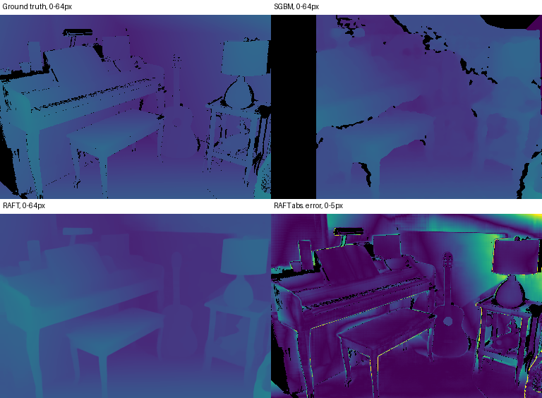

# Stereo confidence on Middlebury

Compare the accuracy and coverage of OpenCV StereoSGBM and the original RAFT-Stereo model on the same rectified image pairs. The comparison below was generated on the held-out Piano scene.



```powershell
python -m pip install -r requirements.txt
python run.py demo
python run.py reproduce
python run.py evaluate
python -m unittest discover -s tests
```

Python 3.11, Git and an internet connection are required for first-time setup. The first two commands that run predictions fetch the pinned source and original weights, plus only the scenes required. The default device is CPU. Use `--cache <directory>` to reuse downloads and `--out scratch/reproduction` to preserve archived results. Evaluation rebuilds the CSV from saved per-pixel predictions. The development demo uses Motorcycle; it does not enter the three-scene holdout.

| Held-out scene | SGBM EPE | RAFT EPE | RAFT EPE at 1 px LR consistency | RAFT coverage at 1 px |
|---|---:|---:|---:|---:|
| Adirondack | 1.020 | 0.426 | 0.260 | 87.8% |
| Piano | 1.154 | 0.575 | 0.422 | 81.2% |
| Shelves | 1.477 | 0.533 | 0.463 | 91.1% |

EPE is measured in pixels at the evaluation width of 384 pixels. Each method is scored on its valid predictions, and the CSV includes coverage against all valid ground-truth pixels. With no extra filtering SGBM covered 79.1–81.3% and RAFT covered 100%. The one-pixel consistency rule retains fewer pixels as it lowers error in all three scenes.

## How the experiment works

- `src/fetch.py` verifies the upstream source revision and the SHA-256 of all inputs. [Upstream and data](UPSTREAM.md). The SceneFlow-only checkpoint avoids using the Middlebury-finetuned model.
- `src/benchmark.py` runs both left and right estimates, accounts for the horizontal flip of reverse-direction inference, and rescales ground-truth disparities by the image width ratio. Black in the figure indicates unavailable values.
- `configs/benchmark.json` fixes scene splits, 12 recurrent updates, resolution and rejection thresholds. The [result CSV](results/metrics.csv) includes coverage, EPE and the fraction exceeding one pixel under four left/right (LR) thresholds. Texture groups are defined from local contrast and repeated horizontal patterns. The occlusion proxy uses cross-view ground-truth visibility and the image border. These masks are operational proxies and can overlap.
- The compact archived `.npz` files hold predictions, truth and region masks for offline scoring. The test subset is small; published full-resolution leaderboard results use a different protocol.
